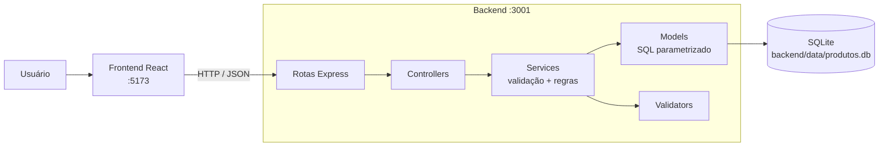

# Desperdício Zero

Aplicação web Full Stack para **controle de estoque e de validade de produtos**, voltada a pequenos mercados, mercearias e minimercados. Projeto acadêmico.

> **Estado atual: Fase 1 (setup) concluída e Fase 2 (CRUD) homologada.** Classificação de validade, filtros por situação e dashboard (Fases 3 e 4) **ainda não existem**. Veja a [Homologação da Fase 2](#homologação-da-fase-2) para saber o que foi verificado e por quem.

## Homologação da Fase 2

| Verificação | Estado | Quem/como |
|---|---|---|
| Fase 1 (estrutura, API, banco, health) | Concluída e aprovada | Auditoria e correções registradas no histórico de trabalho |
| CRUD da Fase 2 | Implementado | — |
| Testes do backend | 42/42 aprovados | Automatizado (`cd backend && npm test`), executado em 2026-10-27 |
| Testes do frontend | 5/5 aprovados | Automatizado (`cd frontend && npm test`), executado em 2026-10-27 |
| Build do frontend | Aprovado | `cd frontend && npm run build`, executado em 2026-10-27 |
| CRUD e persistência no SQLite real | Validados | Execução ponta a ponta com `curl`, incluindo reinício do servidor |
| Interface no navegador | Validada manualmente | **Realizada pelo usuário** (não repetida pelo assistente) |
| Busca, cadastro, edição e exclusão na interface | Validados | **Informado pelo usuário** |
| Responsividade, navegação por teclado, diálogos (Esc), formato `R$ X,XX` | **Não confirmados individualmente** | O usuário informou a validação geral da interface; estes itens não foram listados um a um |

Os testes automatizados do frontend cobrem apenas as funções de moeda e data; os componentes React não têm testes automatizados.

## 1–3. Problema, justificativa e objetivos

**Problema.** O controle manual das datas de validade dificulta identificar a tempo produtos que precisam de atenção; sem acompanhamento, há perdas, desperdício e prejuízo financeiro.

**Justificativa.** O sistema centraliza as informações dos produtos e, nas fases seguintes, destacará os itens prioritários — não é apenas um CRUD. Não promete eliminar o desperdício: fornece informação para reduzi-lo.

**Objetivo geral.** Gerir produtos e datas de validade, contribuindo para um estoque mais eficiente e menos desperdício.

**Objetivos específicos:** cadastrar e gerir produtos · consultar e atualizar o estoque · identificar vencidos e próximos do vencimento · pesquisar e filtrar · apresentar indicadores · estimar o valor em risco · código organizado, testável e de fácil manutenção.

## 4. Público-alvo e contexto

Pequenos mercados, mercearias, minimercados e estabelecimentos com produtos de prazo de validade. Projeto acadêmico de desenvolvimento web Full Stack (interface, regras de negócio, banco de dados, testes e organização de software).

## 5. Funcionalidades

| Estado | Funcionalidade |
|---|---|
| ✅ Implementado e testado | RF01 cadastrar · RF02 listar (ordenado por validade) · RF03 editar com validação · RF04 excluir com confirmação · pesquisa por nome/código · paginação · validação (frontend e backend) |
| ⏳ Pendente (Fase 3) | RF05 classificar vencido/próximo/dentro · RF06 filtrar por categoria e situação · cores 🔴🟡🟢 com texto |
| ⏳ Pendente (Fase 4) | Dashboard com 4 indicadores · RF07 valor em risco |
| ⏳ Pendente (Fase 5) | Testes de fronteira de validade, responsividade e mensagens refinadas |
| 💡 Opcional (Fase 6) | Exportação CSV, relatório PDF, alerta de estoque baixo |

## 6. Tecnologias e justificativa

| Camada | Tecnologia | Por quê |
|---|---|---|
| Frontend | React 19 + Vite 6 | Stack aprovada; componentes reutilizáveis; build rápido |
| Backend | Node.js 20 + Express 5 | Stack aprovada; API HTTP simples |
| Banco | SQLite3 via `better-sqlite3` | Persistente, sem servidor, API síncrona simples |
| Testes | `node:test` (embutido no Node) | Sem dependência extra |

Nenhuma biblioteca de UI ou de estado foi adicionada. Dependências do frontend: apenas `react`, `react-dom`, `vite`, `@vitejs/plugin-react`.

## 7. Arquitetura



O frontend nunca acessa o arquivo do banco. Regras de negócio ficam **só no backend**; o frontend apenas valida campos vazios/negativos/tipos para melhorar a experiência.

## 8. Estrutura de pastas

```
desperdicio-zero/
├── backend/
│   ├── src/
│   │   ├── app.js                 # fábrica do app Express (CORS, JSON, rotas, erros)
│   │   ├── server.js              # abre o banco e escuta a porta
│   │   ├── erros.js               # ErroApp (status HTTP + detalhes)
│   │   ├── db/                    # connection.js (abre SQLite) e schema.sql
│   │   ├── routes/                # health.js, produtos.js
│   │   ├── controllers/           # camada HTTP
│   │   ├── services/              # validação, paginação, tradução de erros do banco
│   │   ├── validators/produto.js  # validação de produto e de data real
│   │   └── models/                # acesso ao SQLite
│   ├── test/                      # testes node:test
│   └── data/                      # produtos.db (ignorado pelo git)
├── frontend/
│   ├── src/
│   │   ├── components/            # Sidebar, Header, ProdutoCard, ProdutoForm, Modal, ConfirmarExclusao, Icones
│   │   ├── pages/                 # HomePage, ProdutosPage
│   │   ├── services/api.js        # comunicação com a API
│   │   └── utils/                 # moeda.js (reais↔centavos), data.js (apresentação)
│   └── index.html
└── README.md
```

## 9. Modelo de dados — tabela `produtos`

| Campo | Tipo | Restrição |
|---|---|---|
| id | INTEGER | PRIMARY KEY AUTOINCREMENT |
| nome | TEXT | NOT NULL |
| codigo | TEXT | NOT NULL UNIQUE |
| categoria | TEXT | NOT NULL (campo de texto) |
| quantidade | INTEGER | NOT NULL, CHECK (quantidade >= 0) |
| preco_unitario | INTEGER | NOT NULL, CHECK (>= 0) — **centavos** |
| data_validade | TEXT | NOT NULL — `YYYY-MM-DD` |

Índice `idx_produtos_data_validade` em `data_validade`. O formato da data **não** tem `CHECK` no banco: é validado pela API.

## 10. Regras de negócio

| Código | Regra | Estado |
|---|---|---|
| RN01 | Vencido = `data_validade < hoje` (hoje não é vencido) | ⏳ Fase 3 |
| RN02 | Próximo = `hoje ≤ validade ≤ hoje+7` (limites inclusivos) | ⏳ Fase 3 |
| RN03 | Dentro = `validade > hoje+7` | ⏳ Fase 3 |
| RN04 | Valor em risco = Σ(quantidade × preço) dos "próximos"; vencidos fora | ⏳ Fase 4 |
| RN05 | quantidade ≥ 0 e preço ≥ 0, em inteiros (centavos) | ✅ Implementado e testado |
| RN06 | Ordenação por `data_validade ASC, id ASC` (estável) | ✅ Implementado e testado |
| RN07 | MVP só alerta, sem bloqueios | — |

**Decisão (contradição registrada):** o PDF deixa em aberto se quantidade 0 é permitida; `claude.md` fixa `≥ 0`. Adotado `≥ 0`.

## 11. API

Base: `http://localhost:3001/api`. Corpo e respostas em JSON. Erros: `{ "erro": "mensagem", "detalhes": { "campo": "mensagem" } }`.

| Método | Rota | Descrição | Sucesso | Erros |
|---|---|---|---|---|
| GET | `/health` | Verifica a API | 200 `{"status":"ok"}` | — |
| GET | `/produtos?busca=&pagina=1&limite=20` | Lista ordenada; `busca` filtra nome ou código (parcial); `limite` 1–100 | 200 `{dados, paginacao:{pagina,limite,total,totalPaginas}}` | 400 parâmetros inválidos |
| GET | `/produtos/:id` | Consulta um produto | 200 | 400 id inválido · 404 |
| POST | `/produtos` | Cria | 201 produto criado | 400 dados inválidos · 409 código duplicado |
| PUT | `/produtos/:id` | Atualiza (todos os campos) | 200 | 400 · 404 · 409 |
| DELETE | `/produtos/:id` | Exclui | 204 | 400 · 404 |

Qualquer rota inexistente: **404** JSON. JSON malformado: **400** JSON. Corpo > 100 kb: 413. Falha interna: 500 genérico (sem detalhes internos).

Corpo de `POST`/`PUT`:
```json
{ "nome": "Leite Integral 1L", "codigo": "LEI001", "categoria": "Laticínios",
  "quantidade": 10, "preco_unitario": 599, "data_validade": "2026-11-15" }
```
`quantidade` e `preco_unitario` devem ser **números inteiros** (o preço em centavos: R$ 5,99 = 599); `data_validade` deve ser uma data real `YYYY-MM-DD` (2026-02-30 é rejeitada).

```bash
curl -X POST localhost:3001/api/produtos -H 'Content-Type: application/json' \
  -d '{"nome":"Leite","codigo":"LEI001","categoria":"Laticínios","quantidade":10,"preco_unitario":599,"data_validade":"2026-11-15"}'
curl "localhost:3001/api/produtos?busca=leit&limite=5"
curl -X DELETE localhost:3001/api/produtos/1
```

## 12–14. Pré-requisitos, instalação e configuração

- Node.js 20 (testado com v20.20.2) e npm 10 (testado com 10.8.2).
- Instalação (cada pasta separadamente):

```bash
cd backend  && npm install
cd frontend && npm install
```

| Variável | Onde | Padrão | Função |
|---|---|---|---|
| `PORT` | backend | `3001` | Porta da API |
| `DB_PATH` | backend | `backend/data/produtos.db` | Arquivo SQLite (`:memory:` aceito) |
| `CORS_ORIGINS` | backend | `http://localhost:5173,http://127.0.0.1:5173` | Origens permitidas, separadas por vírgula. Origens não listadas não recebem cabeçalho CORS |
| `VITE_API_URL` | frontend | `http://localhost:3001/api` | URL da API |

O banco e a tabela são criados automaticamente ao iniciar o backend; dados existentes não são alterados.

## 15–16. Execução, testes e build

Terminais separados:

```bash
cd backend  && npm start        # API em http://localhost:3001  (npm run dev recarrega ao editar)
cd frontend && npm run dev      # UI em http://localhost:5173
```
```bash
cd backend  && npm test         # 42 testes (API + persistência)
cd frontend && npm test         # 5 testes (conversão de moeda e data)
cd frontend && npm run build    # build de produção em frontend/dist
```

## 18. Validação e tratamento de erros

- **Servidor (definitiva):** campos obrigatórios; textos com limite de tamanho; `quantidade`/`preco_unitario` inteiros ≥ 0 e dentro de limite; data real `YYYY-MM-DD` (confere o dia no calendário, anos 1900–2100); código único (violação de UNIQUE do SQLite vira 409); id inteiro positivo. Falha de validação **não grava** nada.
- **Cliente (conveniência):** campos vazios, valores negativos e tipos; o preço é digitado em reais e convertido para centavos inteiros sem ponto flutuante antes do envio. Erros do servidor por campo são exibidos junto ao campo.
- Todo SQL usa parâmetros; a busca escapa `%` e `_`.

## 19. Testes e resultados obtidos

Última execução (2026-10-27, Node 20.20.2):

| Comando | Resultado |
|---|---|
| `cd backend && npm test` | **42 de 42 passaram** |
| `cd frontend && npm test` | **5 de 5 passaram** |
| `cd frontend && npm run build` | ✅ concluído (41 módulos) |
| Ponta a ponta com o banco SQLite real (curl): criar → editar → reiniciar o servidor → consultar → excluir | ✅ dados persistiram após reinício; 400 e 404 em JSON conferidos |

Testes do backend usam banco `:memory:` ou arquivo temporário, nunca `backend/data`.

## 13. Rastreabilidade (documentos → implementação)

| Requisito | Implementação | Teste | Estado |
|---|---|---|---|
| RF01 cadastrar | `POST /produtos`, `ProdutoForm` | criação válida, campos ausentes (cenários PDF 1, 2) | ✅ testado (API) |
| RF02 listar por validade | `GET /produtos` | ordenação estável, lista vazia (PDF 13, 16) | ✅ testado (API) |
| RF03 atualizar com validação | `PUT /produtos/:id` | edição válida/ inválida (PDF 9) | ✅ testado (API) |
| RF04 excluir com confirmação | `DELETE`, `ConfirmarExclusao` | exclusão, 404 (PDF 10) | ✅ API testada · confirmação na UI validada manualmente pelo usuário (informado) |
| Preço negativo / quantidade negativa | validador + `CHECK` | PDF 3 e 4 | ✅ testado |
| Pesquisa nome/código | `?busca=` | PDF 11 (categoria: ⏳ Fase 3) | ✅ nome e código testados |
| RN05, RN06 | validador, `ORDER BY` | sim | ✅ |
| RNF04 validação front + back | `validators`, `ProdutoForm` | back testado; front não automatizado | ⚠️ parcial |
| RNF06 consistência indicadores | — | — | ⏳ Fase 4 |
| RF05, RF06, RF07, RN01–RN04, cenários PDF 5–8, 12, 14, 15 | — | — | ⏳ Fases 3–4 |
| RNF08 responsividade | CSS com `@media` | — | ⚠️ não confirmada individualmente (validação geral da UI feita pelo usuário) |
| RNF05 segurança básica | sem credenciais; CORS restrito | CORS testado | ✅ |

## 20. Uso da interface

**Home:** apresentação (indicadores virão na Fase 4). **Produtos:** lista à esquerda com busca (por nome ou código, com atraso de 300 ms), botão **Atualizar**, **Novo produto**, **Editar** e **Excluir** (pede confirmação) em cada item; paginação de 10 em 10. À direita, painel de resumo reservado para a Fase 4. Preços aparecem como `R$ X,XX`. Diálogos fecham com Esc.

## 21. Resolução de problemas

| Sintoma | Causa e solução |
|---|---|
| `npm install` do frontend falha com `Cannot read properties of null (reading 'edgesOut')` | O npm 10 falhou com Vite 8 + plugin-react 6 (reproduzido isoladamente). Por isso as versões estão **fixadas** em `frontend/package.json` (Vite ~6.4, plugin-react ~4.7, React ~19.1). Não rode `npm update` sem testar. |
| `npm install` parece travado | Há outro `npm install` rodando na mesma pasta (`pgrep -fa "npm install"`); encerre-o. Instalações sobrepostas travam. |
| Tela mostra "Não foi possível comunicar com o servidor" | Backend desligado ou porta diferente: inicie com `npm start` e confira `VITE_API_URL`. |
| Erro de CORS no navegador | A origem do frontend não está em `CORS_ORIGINS`. |
| `EADDRINUSE` | Porta 3001 ocupada; defina `PORT`. |
| `better-sqlite3` não compila/instala | Use Node 20 e `npm install` novamente (baixa binário pré-compilado). |

## 22. Limitações conhecidas

- A interface foi validada manualmente pelo usuário, mas **não por testes automatizados**: os componentes React não têm testes. Responsividade, teclado e diálogos não foram confirmados individualmente.
- Busca por texto não ignora acentos (`LIKE` do SQLite só ignora maiúsculas ASCII).
- `data_validade` não tem `CHECK` de formato no banco; a validação é da API.
- Sem autenticação, vendas, notificações, IA ou app móvel (fora de escopo).

## 23. Fases seguintes

3. Classificação de validade (RN01–RN03), cores com texto, filtros por categoria e situação.
4. Dashboard com 4 indicadores e valor em risco (RN04), painel direito.
5. Testes de fronteira (hoje, +7, +8 dias), responsividade, consistência dos indicadores.
6. Opcionais: CSV, PDF, estoque baixo.

## 24. Apresentação/demonstração

Roteiro sugerido: (1) mostrar a arquitetura (diagrama acima); (2) cadastrar um produto e tentar um com preço negativo; (3) pesquisar por nome e por código; (4) editar quantidade; (5) excluir com confirmação; (6) reiniciar o backend e mostrar que os dados persistem; (7) executar `npm test`. Referência visual: sidebar escura, cabeçalho claro, lista à esquerda e resumo à direita (aproveitando só o layout; vendas, lojas, carrinho e código de barras estão fora de escopo).
