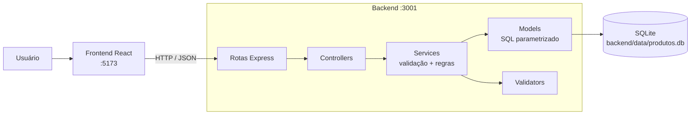
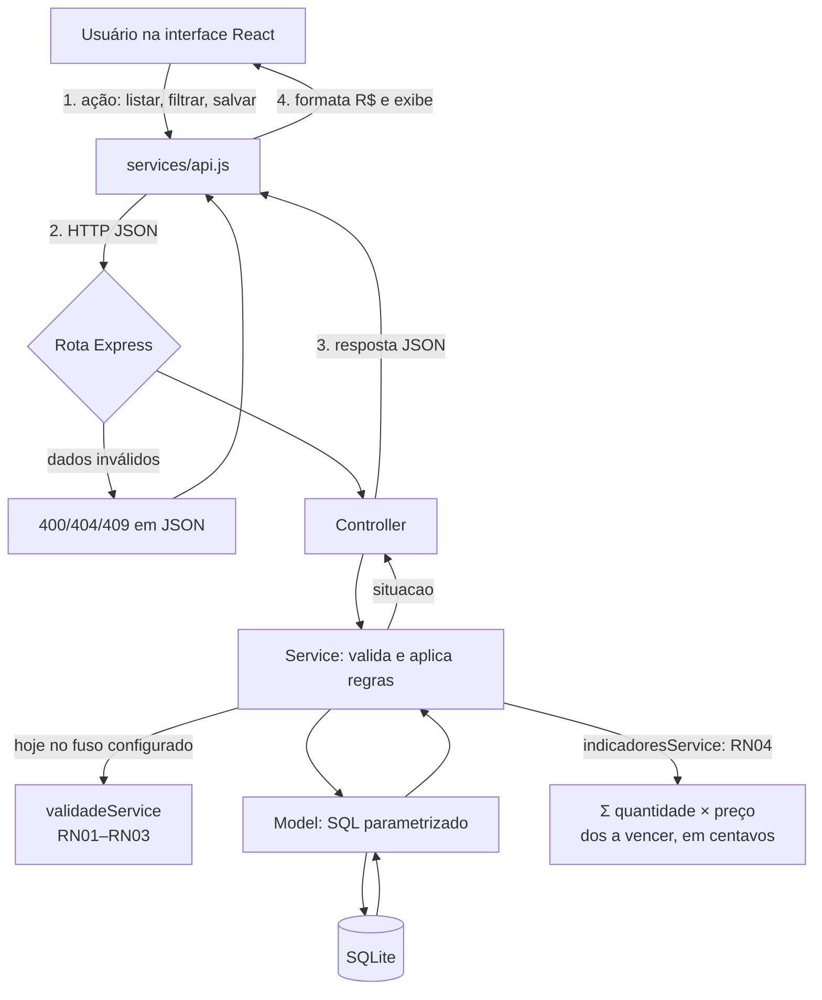

# Desperdício Zero

Aplicação web Full Stack para **controle de estoque e de validade de produtos**, voltada a pequenos mercados, mercearias e minimercados. Projeto acadêmico.

> **Estado atual: Fases 1 a 5 homologadas manualmente pelo usuário (informado). Fase 6 (extras opcionais: CSV, relatório em PDF por impressão e alerta de estoque baixo) e as melhorias de menu responsivo, gráficos e tela de relatórios estão implementadas e verificadas por testes automatizados — a validação manual da Fase 6 está PENDENTE do usuário.** A Fase 7 não existe nos documentos e não foi iniciada.

## Homologação da Fase 2

| Verificação | Estado | Quem/como |
|---|---|---|
| Fase 1 (estrutura, API, banco, health) | Concluída e aprovada | Auditoria e correções registradas no histórico de trabalho |
| CRUD da Fase 2 | Implementado | — |
| Testes do backend (na homologação da Fase 2) | 42/42 aprovados | Automatizado, executado em 2026-10-27 |
| Testes do frontend | 5/5 aprovados | Automatizado (`cd frontend && npm test`), executado em 2026-10-27 |
| Build do frontend | Aprovado | `cd frontend && npm run build`, executado em 2026-10-27 |
| CRUD e persistência no SQLite real | Validados | Execução ponta a ponta com `curl`, incluindo reinício do servidor |
| Interface no navegador | Validada manualmente | **Realizada pelo usuário** (não repetida pelo assistente) |
| Busca, cadastro, edição e exclusão na interface | Validados | **Informado pelo usuário** |
| Responsividade, navegação por teclado, diálogos (Esc), formato `R$ X,XX` | **Não confirmados individualmente** | O usuário informou a validação geral da interface; estes itens não foram listados um a um |

Os testes automatizados do frontend cobrem apenas as funções de moeda e data; os componentes React não têm testes automatizados.

## 1–3. Problema, justificativa e objetivos

**Problema.** O controle manual das datas de validade dificulta identificar a tempo produtos que precisam de atenção; sem acompanhamento, há perdas, desperdício e prejuízo financeiro.

**Justificativa.** O sistema centraliza as informações dos produtos e, nas fases seguintes, destacará os itens prioritários — não é apenas um CRUD. Não promete eliminar o desperdício: fornece informação para reduzi-lo.

**Objetivo geral.** Gerir produtos e datas de validade, contribuindo para um estoque mais eficiente e menos desperdício.

**Objetivos específicos:** cadastrar e gerir produtos · consultar e atualizar o estoque · identificar vencidos e próximos do vencimento · pesquisar e filtrar · apresentar indicadores · estimar o valor em risco · código organizado, testável e de fácil manutenção.

## 4. Público-alvo e contexto

Pequenos mercados, mercearias, minimercados e estabelecimentos com produtos de prazo de validade. Projeto acadêmico de desenvolvimento web Full Stack (interface, regras de negócio, banco de dados, testes e organização de software).

## 5. Funcionalidades

| Estado | Funcionalidade |
|---|---|
| ✅ Implementado e testado | RF01 cadastrar · RF02 listar (ordenado por validade) · RF03 editar com validação · RF04 excluir com confirmação · pesquisa por nome/código · paginação · validação (frontend e backend) |
| ✅ Implementado e testado automaticamente (Fase 3); validação manual pendente | RF05 classificar vencido / a vencer / dentro da validade (`situacao`) · RF06 filtrar por situação e por categoria, combinados com busca e paginação · selo com cor **e** texto |
| ✅ Implementado e testado automaticamente (Fase 4); validação manual pendente | Dashboard com 4 indicadores (total de produtos, vencidos, a vencer em 7 dias, valor estimado em risco) · RF07 valor em risco (RN04) |
| ✅ Implementado e testado automaticamente (Fase 5); validação manual pendente | Testes de fronteira (datas, valores negativos, campos vazios), conferência dos indicadores contra a base, 5 defeitos corrigidos (3 de validação/entrada, 2 de interface), refinamentos de interface (ver [Fase 5](#fase-5--testes-e-refinamento)) |
| ✅ Implementado e testado automaticamente (Fase 6); validação manual pendente | Exportação CSV da lista de produtos a vencer · relatório em PDF (impressão do navegador, "Salvar como PDF") · alerta de estoque baixo com limite mínimo por produto · menu hambúrguer em telas pequenas · gráficos na Home · tela de Relatórios (ver [Fase 6](#fase-6--extras-menu-responsivo-gráficos-e-relatórios)) |

## 6. Tecnologias e justificativa

| Camada | Tecnologia | Por quê |
|---|---|---|
| Frontend | React 19 + Vite 6 | Stack aprovada; componentes reutilizáveis; build rápido |
| Backend | Node.js 20 + Express 5 | Stack aprovada; API HTTP simples |
| Banco | SQLite3 via `better-sqlite3` | Persistente, sem servidor, API síncrona simples |
| Testes | `node:test` (embutido no Node) | Sem dependência extra |

Nenhuma biblioteca de UI ou de estado foi adicionada. Dependências do frontend: apenas `react`, `react-dom`, `vite`, `@vitejs/plugin-react`.

## 7. Arquitetura



O frontend nunca acessa o arquivo do banco. Regras de negócio ficam **só no backend**; o frontend apenas valida campos vazios/negativos/tipos para melhorar a experiência.

## 8. Estrutura de pastas

```
desperdicio-zero/
├── backend/
│   ├── src/
│   │   ├── app.js                 # fábrica do app Express (CORS, JSON, rotas, erros)
│   │   ├── server.js              # abre o banco e escuta a porta
│   │   ├── erros.js               # ErroApp (status HTTP + detalhes)
│   │   ├── db/                    # connection.js (abre SQLite) e schema.sql
│   │   ├── routes/                # health.js, produtos.js, categorias.js, indicadores.js, relatorios.js
│   │   ├── controllers/           # camada HTTP
│   │   ├── services/              # produtoService (CRUD, filtros, paginação), validadeService (RN01–RN03, data local), indicadoresService (RN04, indicadores e detalhe por categoria), estoqueService (estoque baixo), relatorioService e csvService (CSV)
│   │   ├── validators/produto.js  # validação de produto e de data real
│   │   └── models/                # acesso ao SQLite
│   ├── test/                      # testes node:test
│   └── data/                      # produtos.db (ignorado pelo git)
├── frontend/
│   ├── src/
│   │   ├── components/            # Sidebar (menu/gaveta), Header (hambúrguer), Indicadores, graficos/ (RoscaSituacao, BarrasValorCategoria, GraficosIndicadores), TabelaCategorias, AlertaEstoqueBaixo, SeloSituacao, ProdutoCard, ProdutoForm, Modal, ConfirmarExclusao, Icones
│   │   ├── hooks/                 # useIndicadores, useMediaQuery
│   │   ├── pages/                 # HomePage, ProdutosPage, RelatoriosPage
│   │   ├── services/api.js        # comunicação com a API
│   │   └── utils/                 # moeda.js (reais↔centavos), data.js (apresentação)
│   └── index.html
└── README.md
```

## 9. Modelo de dados — tabela `produtos`

| Campo | Tipo | Restrição |
|---|---|---|
| id | INTEGER | PRIMARY KEY AUTOINCREMENT |
| nome | TEXT | NOT NULL |
| codigo | TEXT | NOT NULL UNIQUE |
| categoria | TEXT | NOT NULL (campo de texto) |
| quantidade | INTEGER | NOT NULL, CHECK (quantidade >= 0) |
| preco_unitario | INTEGER | NOT NULL, CHECK (>= 0) — **centavos** |
| data_validade | TEXT | NOT NULL — `YYYY-MM-DD` |
| estoque_minimo | INTEGER | NOT NULL DEFAULT 0, CHECK (>= 0) — limite do alerta de estoque baixo; 0 = sem alerta (**Fase 6**) |

Índice `idx_produtos_data_validade` em `data_validade`. O formato da data **não** tem `CHECK` no banco: é validado pela API.

**Migração aditiva da Fase 6.** Bancos criados antes da Fase 6 não têm `estoque_minimo`. Ao iniciar o backend (`criarConexao`), se a coluna não existir o sistema: (1) grava uma cópia consistente do banco em `<pasta do banco>/backups/<nome>-AAAAMMDD-HHMMSS-antes-estoque-minimo.db` (`VACUUM INTO`); (2) executa `ALTER TABLE produtos ADD COLUMN estoque_minimo INTEGER NOT NULL DEFAULT 0 CHECK (estoque_minimo >= 0)`. Nenhum produto é alterado ou apagado (todos ficam com limite 0, sem alerta). É idempotente: com a coluna já presente, nada é feito e nenhum backup novo é criado. Bancos novos já nascem com a coluna. A pasta `backups/` fica fora do Git (`*.db`).

## 10. Regras de negócio

| Código | Regra | Estado |
|---|---|---|
| RN01 | Vencido = `data_validade < hoje` (hoje não é vencido) | ✅ Implementado e testado automaticamente |
| RN02 | A vencer (`proximo`) = `hoje ≤ validade ≤ hoje+7` (limites inclusivos) | ✅ Implementado e testado automaticamente |
| RN03 | Dentro da validade (`dentro`) = `validade > hoje+7` | ✅ Implementado e testado automaticamente |
| RN04 | Valor em risco = Σ(quantidade × preço) dos "próximos"; vencidos fora | ✅ Implementado e testado automaticamente |
| RN05 | quantidade ≥ 0 e preço ≥ 0, em inteiros (centavos) | ✅ Implementado e testado |
| RN06 | Ordenação por `data_validade ASC, id ASC` (estável) | ✅ Implementado e testado |
| RN07 | MVP só alerta, sem bloqueios | — |

**Como a validade é calculada (Fase 3).** Tudo em `backend/src/services/validadeService.js`; o frontend apenas exibe o campo `situacao`.

- **Constante única:** `JANELA_ALERTA_DIAS = 7` (RN02). A janela não é configurável em tempo de execução (fora do escopo do MVP).
- **Data de hoje:** calculada no backend no fuso **`America/Sao_Paulo`** (padrão), configurável por `APP_TIME_ZONE`. Usa `Intl.DateTimeFormat`, nunca `toISOString()` (que é UTC e daria o dia errado à noite no Brasil).
- **Aritmética de calendário:** `hoje + 7` é somado sobre ano/mês/dia, não em milissegundos; não sofre efeito de horário de verão.
- **Fuso inválido** em `APP_TIME_ZONE` impede a API de iniciar, com mensagem clara (não cai silenciosamente para UTC).
- **Um só conjunto de limites** serve para classificar e para filtrar no SQL (`intervaloSituacao`), então o campo `situacao` e o filtro `?situacao=` nunca divergem.
- Datas inválidas ou fora de `YYYY-MM-DD` real são recusadas.

**Indicadores e valor em risco (Fase 4, RN04).** Definidos em `backend/src/services/indicadoresService.js`; o frontend só exibe os números recebidos de `GET /api/indicadores`.

| Indicador | Campo da API | Definição |
|---|---|---|
| Total de produtos | `total_produtos` | Número de **produtos diferentes** cadastrados (linhas de `produtos`). Não é o total de unidades |
| Produtos vencidos | `produtos_vencidos` | Produtos com situação `vencido` (RN01: `validade < hoje`) |
| A vencer em 7 dias | `produtos_a_vencer` | Produtos com situação `proximo` (RN02: `hoje ≤ validade ≤ hoje+7`, hoje incluído) |
| Valor estimado em risco | `valor_em_risco` | **Σ (quantidade × preco_unitario)** dos produtos a vencer, em **centavos inteiros** |

- **Quem entra no valor em risco:** só a janela `hoje … hoje+7`. **Não entram** vencidos nem produtos dentro da validade.
- **Quantidade 0 ou preço 0:** o produto continua contando em "a vencer" e contribui com R$ 0,00.
- **Sem produtos elegíveis (ou sem produtos):** todos os indicadores são 0; o valor é R$ 0,00.
- **Exemplo do PDF:** A (10 × R$ 5,00) + B (8 × R$ 3,00) = 10×500 + 8×300 = 5000 + 2400 = **7400 centavos** → R$ 74,00.
- **Estimativa, não prejuízo:** o texto da interface descreve o valor como estimativa; o sistema não sabe se o produto será vendido, devolvido ou descartado.
- **Escopo:** os indicadores são sempre do **estoque inteiro**; busca, categoria e situação da listagem não os alteram. O valor de produtos vencidos **não** é apresentado em separado (o PDF deixa a critério da equipe; a interface mostra só a contagem de vencidos).
- **Precisão:** a soma é feita em inteiros no SQLite, lida como `BigInt` e só convertida para número quando cabe nos inteiros seguros do JavaScript (≤ 9.007.199.254.740.991 centavos); acima disso a API responde 500 genérico em vez de devolver um valor impreciso. O formato `R$ 1.234,56` é produzido no frontend por aritmética inteira, sem ponto flutuante.
- **Mesma data de referência:** as três contagens e o valor usam a mesma data local (`America/Sao_Paulo` ou `APP_TIME_ZONE`) lida uma única vez por requisição, e os mesmos limites de `intervaloSituacao` da Fase 3.

**Decisões registradas.** (1) O PDF chama as RNs de "propostas a confirmar" e o `claude.md` de "definidas"; o usuário decidiu adotá-las como definidas. (2) Textos de dias restantes ("vence em 3 dias") ficaram fora do escopo. (3) O PDF deixa em aberto se quantidade 0 é permitida; `claude.md` fixa `≥ 0` — adotado `≥ 0`. (4) Fase 4: o total de produtos conta produtos diferentes (opção recomendada pelo PDF §6.3); o total de unidades, opcional, não foi implementado. (5) Posição dos indicadores: o PDF e o `claude.md` pedem 4 cards no topo e a imagem de referência traz o resumo à direita; adotou-se os dois, com um único componente: cards na **Home** (painel inicial) e painel **Resumo do estoque** à direita na página Produtos.

## 11. API

Base: `http://localhost:3001/api`. Corpo e respostas em JSON. Erros: `{ "erro": "mensagem", "detalhes": { "campo": "mensagem" } }`.

| Método | Rota | Descrição | Sucesso | Erros |
|---|---|---|---|---|
| GET | `/health` | Verifica a API | 200 `{"status":"ok"}` | — |
| GET | `/produtos?busca=&categoria=&situacao=&pagina=1&limite=20` | Lista ordenada; `busca` filtra nome ou código (parcial); `categoria` filtra por igualdade exata; `situacao` = `vencido`, `proximo` ou `dentro`; `estoque=baixo` lista só produtos com estoque baixo; `limite` 1–100. Parâmetro vazio = sem filtro. Os filtros combinam-se (E) e valem antes da paginação | 200 `{dados, paginacao:{pagina,limite,total,totalPaginas}}` | 400 parâmetros inválidos (inclui `situacao` fora da lista e parâmetro repetido) |
| GET | `/categorias` | Categorias distintas realmente cadastradas, em ordem alfabética estável | 200 `{"dados": ["Grãos", "Laticínios"]}` (lista vazia sem produtos) | — |
| GET | `/relatorios/produtos-a-vencer.csv` | CSV dos produtos a vencer (hoje…hoje+7), por validade e id (Fase 6) | 200 `text/csv; charset=utf-8`, anexo | — |
| GET | `/indicadores` | Indicadores do dashboard e valor em risco (RN04), do estoque inteiro; inclui `produtos_dentro`, `produtos_estoque_baixo` e `por_categoria`; sem parâmetros | 200 (exemplo abaixo) | 500 genérico se a soma exceder o limite seguro |
| GET | `/produtos/:id` | Consulta um produto | 200 | 400 id inválido · 404 |
| POST | `/produtos` | Cria | 201 produto criado | 400 dados inválidos · 409 código duplicado |
| PUT | `/produtos/:id` | Atualiza (todos os campos) | 200 | 400 · 404 · 409 |
| DELETE | `/produtos/:id` | Exclui | 204 | 400 · 404 |

Qualquer rota inexistente: **404** JSON. JSON malformado: **400** JSON. Corpo > 100 kb: 413. Falha interna: 500 genérico (sem detalhes internos).

Todas as respostas de produto (`GET`, `POST`, `PUT`) incluem **`estoque_minimo`** e **`estoque_baixo`** (calculado pelo backend, não aceito na entrada) e **`situacao`** (`vencido`, `proximo` ou `dentro`), calculada pelo backend e **não aceita na entrada**. Exemplo, com hoje = 2026-11-10:
```json
{ "id": 3, "nome": "Queijo Minas", "codigo": "QUE1", "categoria": "Laticínios",
  "quantidade": 10, "preco_unitario": 599, "data_validade": "2026-11-17", "situacao": "proximo" }
```
Exemplo de `GET /api/indicadores` (hoje = 2026-10-27, produtos A: 10 × 500 c. e B: 8 × 300 c. a vencer; C vencido; D dentro da validade — resposta obtida em execução real em banco temporário):
```json
{ "total_produtos": 4, "produtos_vencidos": 1, "produtos_a_vencer": 2,
  "valor_em_risco": 7400, "janela_alerta_dias": 7, "data_referencia": "2026-10-27" }
```
`valor_em_risco` está em **centavos** (7400 = R$ 74,00). `janela_alerta_dias` e `data_referencia` permitem à interface explicar o cálculo sem repetir a regra.

Erro de filtro: `GET /api/produtos?situacao=atrasado` → 400 `{"erro":"Parâmetros inválidos","detalhes":{"situacao":"situacao deve ser um de: vencido, proximo, dentro"}}`.

**`estoque_minimo` na entrada (Fase 6):** opcional, inteiro ≥ 0 (até 1.000.000). Ausente no `POST` = 0 (sem alerta); ausente no `PUT` **preserva** o limite já configurado. `null`, decimais, texto e negativos devolvem 400.

**Exemplo de `GET /api/indicadores` com a Fase 6** (4 produtos: Leite 10 × R$ 5,00 e Queijo 8 × R$ 3,00 a vencer; Arroz vencido; Feijão dentro; Leite com `estoque_minimo` 15 — resposta obtida em execução real, banco em memória, data de referência fixa):
```json
{ "total_produtos": 4, "produtos_vencidos": 1, "produtos_a_vencer": 2, "produtos_dentro": 1,
  "valor_em_risco": 7400, "produtos_estoque_baixo": 1,
  "por_categoria": [
    { "categoria": "Laticínios", "total_produtos": 2, "produtos_vencidos": 0, "produtos_a_vencer": 2, "produtos_dentro": 0, "valor_em_risco": 7400 },
    { "categoria": "Grãos", "total_produtos": 2, "produtos_vencidos": 1, "produtos_a_vencer": 0, "produtos_dentro": 1, "valor_em_risco": 0 } ],
  "janela_alerta_dias": 7, "data_referencia": "2026-11-10" }
```
`por_categoria` vem do mesmo cálculo e das mesmas definições do total (a soma das categorias é igual ao total geral); ordem: maior valor em risco primeiro, empate por nome. Os campos antigos mantêm a mesma definição.

**`GET /api/relatorios/produtos-a-vencer.csv`** (mesmos dados; separador de colunas `;`, UTF-8 com BOM, quebras CRLF, valores em reais com vírgula decimal, datas `YYYY-MM-DD`. **Toda célula que contém vírgula, `;`, aspas ou quebra de linha vai entre aspas** — por isso `"5,99"` não é partido em duas colunas mesmo que o programa de planilha trate a vírgula como separador. Células de texto que começam com `=`, `+`, `-` ou `@` recebem um apóstrofo para não virarem fórmulas; toda linha tem exatamente as 7 colunas do cabeçalho, e o gerador recusa linhas com outro número de colunas):
```
Código;Nome;Categoria;Quantidade;Preço unitário (R$);Data de validade;Valor estimado (R$)
LEI001;Leite Integral 1L;Laticínios;10;"5,00";2026-11-12;"50,00"
QUE001;Queijo Minas;Laticínios;8;"3,00";2026-11-17;"24,00"
```
A soma da última coluna é o valor em risco (R$ 74,00). Defeito corrigido: antes as vírgulas decimais saíam sem aspas e leitores que também aceitam `,` como separador partiam `5,99` em `5` e `99` (9 colunas em vez de 7); o arquivo continua sendo UTF-8 com BOM e delimitado por `;`. Sem produtos a vencer, o arquivo traz só o cabeçalho.

Corpo de `POST`/`PUT`:
```json
{ "nome": "Leite Integral 1L", "codigo": "LEI001", "categoria": "Laticínios",
  "quantidade": 10, "preco_unitario": 599, "data_validade": "2026-11-15" }
```
`quantidade` e `preco_unitario` devem ser **números inteiros** (o preço em centavos: R$ 5,99 = 599); `data_validade` deve ser uma data real `YYYY-MM-DD` (2026-02-30 é rejeitada).

```bash
curl -X POST localhost:3001/api/produtos -H 'Content-Type: application/json' \
  -d '{"nome":"Leite","codigo":"LEI001","categoria":"Laticínios","quantidade":10,"preco_unitario":599,"data_validade":"2026-11-15"}'
curl "localhost:3001/api/produtos?busca=leit&limite=5"
curl "localhost:3001/api/produtos?situacao=proximo&categoria=Latic%C3%ADnios&pagina=1"
curl localhost:3001/api/categorias
curl localhost:3001/api/indicadores
curl -X DELETE localhost:3001/api/produtos/1
```

## 12–14. Pré-requisitos, instalação e configuração

- Node.js 20.6 ou superior (testado com v20.20.2; o teste do frontend usa `node --import`) e npm 10 (testado com 10.8.2).
- Instalação (cada pasta separadamente):

```bash
cd backend  && npm install
cd frontend && npm install
```

| Variável | Onde | Padrão | Função |
|---|---|---|---|
| `PORT` | backend | `3001` | Porta da API |
| `DB_PATH` | backend | `backend/data/produtos.db` | Arquivo SQLite (`:memory:` aceito) |
| `CORS_ORIGINS` | backend | `http://localhost:5173,http://127.0.0.1:5173` | Origens permitidas, separadas por vírgula. Origens não listadas não recebem cabeçalho CORS |
| `APP_TIME_ZONE` | backend | `America/Sao_Paulo` | Fuso usado para "hoje" na regra de validade (identificador IANA). Inválido = a API não inicia |
| `VITE_API_URL` | frontend | `http://localhost:3001/api` | URL da API |

O banco e a tabela são criados automaticamente ao iniciar o backend; dados existentes não são alterados.

## 15–16. Execução, testes e build

Terminais separados:

```bash
cd backend  && npm start        # API em http://localhost:3001  (npm run dev recarrega ao editar)
cd frontend && npm run dev      # UI em http://localhost:5173
```
```bash
cd backend  && npm test         # 201 testes (API, validade, filtros, indicadores, fronteiras, fluxos, relatórios, estoque, migração)
cd frontend && npm test         # 80 testes (moeda/data, menu, gráficos, Top 10, consultas assíncronas, componentes e interação com jsdom)
cd frontend && npm run build    # build de produção em frontend/dist
```

## 18. Validação e tratamento de erros

- **Servidor (definitiva):** campos obrigatórios; textos com limite de tamanho; `quantidade`/`preco_unitario` inteiros ≥ 0 e dentro de limite; data real `YYYY-MM-DD` (confere o dia no calendário, anos 1900–2100); código único (violação de UNIQUE do SQLite vira 409); id inteiro positivo. Falha de validação **não grava** nada.
- **Cliente (conveniência):** campos vazios, valores negativos e tipos; o preço é digitado em reais e convertido para centavos inteiros sem ponto flutuante antes do envio. Erros do servidor por campo são exibidos junto ao campo.
- Todo SQL usa parâmetros; a busca escapa `%` e `_`.

## 19. Testes e resultados obtidos

Última execução (2026-10-27, Node 20.20.2), na conclusão da Fase 6:

| Comando | Resultado |
|---|---|
| `cd backend && npm test` | **201 de 201 passaram** (42 da Fase 2 + 46 da Fase 3 + 21 da Fase 4 + 53 da Fase 5 + 30 da Fase 6 + 9 da correção do CSV) |
| `cd frontend && npm test` | **80 de 80 passaram** (10 anteriores + 27 da Fase 6 + 26 de Top 10 e seção recolhível + 17 do botão Atualizar) |
| `cd frontend && npm run build` | ✅ concluído |
| Ponta a ponta com o banco SQLite real (curl), na Fase 2: criar → editar → reiniciar → consultar → excluir | ✅ dados persistiram após reinício; 400 e 404 em JSON conferidos |
| Fase 3 com o **relógio real**, banco temporário (curl): produtos com validade ontem, hoje, +7 e +8 dias em São Paulo | ✅ `vencido`, `proximo`, `proximo`, `dentro`; filtros e `/categorias` coerentes |
| Fase 4 com o relógio real, banco temporário (curl): exemplo do PDF (A 10×R$5,00, B 8×R$3,00, C vencido, D +8 dias) | ✅ `valor_em_risco` = 7400, `produtos_a_vencer` = 2, `produtos_vencidos` = 1, `total_produtos` = 4; após excluir A: 2400, 1, 1, 3. Banco vazio: tudo 0 |
| Fase 5: indicadores e `situacao` conferidos contra um **oráculo independente** sobre uma **cópia** do banco de desenvolvimento (3 produtos reais) | ✅ API = oráculo (total 3, vencidos 1, a vencer 1, valor em risco R$ 149,75); o arquivo original não foi alterado (hash idêntico antes e depois) |
| Fase 6: **migração sobre uma cópia do banco de desenvolvimento** (3 produtos reais) iniciando o `server.js` | ✅ coluna criada, dados idênticos (`diff` vazio), `estoque_minimo` = 0 nos três, backup gravado sem a coluna nova, API e CSV respondendo; o arquivo original ficou com o mesmo hash e sem pasta `backups/` |
| `APP_TIME_ZONE=Marte/Olimpo node src/server.js` | ✅ a API não inicia; mensagem clara e código de saída 1 |

**Testes novos da Fase 3** (`backend/test/validade.test.js` e `filtros.test.js`, data de referência fixa em 2026-11-10, nunca o relógio real): limites ontem/hoje/+7/+8 (cenários PDF 5–8) e o exemplo do PDF (hoje = 10/10); virada de mês e de ano; 29/02 bissexto e ano não bissexto; datas inválidas; instante que cruza a meia-noite UTC e ainda é outro dia em São Paulo; fuso padrão, configurado e inválido; `situacao` em POST/GET/PUT/listagem; cada filtro isolado e todas as combinações com busca e paginação; total e metadados; 400 para situação inválida ou repetida; coerência `situacao` × filtro; ordenação estável; `/api/categorias` (vazia, distintas, ordem, reflexo de edição e exclusão). 

**Testes novos da Fase 4** (`backend/test/indicadores.test.js`, data fixa 2026-11-10): sem produtos (cenário 16); exemplo do PDF = R$ 74,00 (cenário 15); janela inclusiva (ontem e +8 fora; hoje e +7 dentro); vencidos e "dentro" fora do valor; quantidade 0; preço 0; vários produtos conferidos com cálculo independente em BigInt; precisão em centavos (10 + 20 = 30); categorias distintas; editar quantidade, preço e validade; excluir; cadastro inválido ou duplicado não altera nada; API de listagem × indicadores (cenário 14); filtros da listagem não alteram os indicadores; método diferente de GET → 404; soma acima do limite seguro → 500 genérico; produto no limite máximo. A interface React **não** tem testes automatizados.

**Testes novos da Fase 5** (`backend/test/fronteiras.test.js`, `consistencia.test.js`, `fluxos.test.js` e ampliação de `frontend/src/utils/moeda.test.js`):
- *Datas:* anos 1900/2100 e vizinhos, regra dos séculos (1900 e 2100 não são bissextos, 2000 é), último dia de cada mês e o seguinte, dia/mês 00 e 13, formatos quase corretos (espaços, `/`, hora, dígitos de outro alfabeto), tipos que não são texto, extremos classificados, edição para data inválida.
- *Valores:* zero aceito, negativos recusados, `-0`, limite superior exato e um acima, decimais, texto, booleanos, listas, números enormes.
- *Texto:* vazio, espaços, tabulação, quebra de linha, tipos errados, tamanhos exatos e um acima, acentos/emoji/HTML, duplicidade ignorando espaços.
- *Corpo e parâmetros:* corpo ausente/nulo/lista, 413, várias falhas de uma vez, campos desconhecidos e `situacao` enviada (ignorada), paginação absurda, ids fora do intervalo seguro, injeção SQL.
- *Consistência (cenários PDF 14 e 15):* 5 conjuntos de 300 produtos pseudoaleatórios (semente fixa) com o cálculo da API comparado a um oráculo por diferença de dias; cada `situacao` de 250 produtos; cada filtro de situação; todas as datas de −3 a +12 dias; sequência de criar/editar/excluir.
- *Fluxos (combinam vários cenários do PDF §12):* cadastrar → listar → filtrar → indicadores → editar → buscar → excluir; operações inválidas sem rastros; **o `server.js` real em processo separado** (health, persistência após reiniciar o processo, `APP_TIME_ZONE` válido e inválido, CORS padrão e `CORS_ORIGINS`).

As suítes novas foram validadas também por **mutação**: ao quebrar de propósito uma regra (aceitar negativo, ano mínimo, janela de 6 ou 8 dias, soma errada, valor de vencidos, CORS curinga, paginação), os testes passaram a falhar; o código foi restaurado em seguida.

Testes do backend usam banco `:memory:` ou arquivo temporário, nunca `backend/data`.

## 13. Rastreabilidade (documentos → implementação)

| Requisito | Implementação | Teste | Estado |
|---|---|---|---|
| RF01 cadastrar | `POST /produtos`, `ProdutoForm` | criação válida, campos ausentes (cenários PDF 1, 2) | ✅ testado (API) |
| RF02 listar por validade | `GET /produtos` | ordenação estável, lista vazia (PDF 13, 16) | ✅ testado (API) |
| RF03 atualizar com validação | `PUT /produtos/:id` | edição válida/ inválida (PDF 9) | ✅ testado (API) |
| RF04 excluir com confirmação | `DELETE`, `ConfirmarExclusao` | exclusão, 404 (PDF 10) | ✅ API testada · confirmação na UI validada manualmente pelo usuário (informado) |
| Preço negativo / quantidade negativa | validador + `CHECK` | PDF 3 e 4 | ✅ testado |
| Pesquisa nome/código | `?busca=` | busca isolada e combinada | ✅ testado (API) |
| RN05, RN06 | validador, `ORDER BY` | sim | ✅ |
| RNF04 validação front + back | `validators`, `ProdutoForm` | back testado; front não automatizado | ⚠️ parcial |
| RF05 classificar vencidos e próximos; RN01, RN02, RN03 | `validadeService.classificar`, campo `situacao`, `SeloSituacao` | `validade.test.js`, `filtros.test.js` (PDF cenários 5, 6, 7, 8) | ✅ testado (API). Selo na UI: **validação manual pendente** |
| PDF §6.1 cor + texto | `SeloSituacao` (texto "Vencido", "A vencer", "Dentro da validade" + cor) | — (sem teste de componente) | ⏳ validação manual pendente |
| RF06 filtrar por situação (PDF cenário 12) | `?situacao=`, seletor "Situação" | situação isolada, combinada, inválida | ✅ API testada · UI: validação manual pendente |
| RF06 filtrar por categoria (PDF cenário 11) | `?categoria=`, `GET /categorias`, seletor "Categoria" | categoria isolada, combinada, lista de categorias | ✅ API testada · UI: validação manual pendente |
| Ordenação com filtros (PDF cenário 13; RN06) | `ORDER BY data_validade ASC, id ASC` | desempate por id com filtro | ✅ testado |
| Data local (decisão D1) | `dataHoje`, `APP_TIME_ZONE` | fronteira UTC × São Paulo, fuso inválido | ✅ testado |
| RF07 / RN04 valor em risco (PDF cenário 15) | `indicadoresService.obter`, `GET /indicadores`, card "Valor estimado em risco" | `indicadores.test.js` (fórmula, janela, zeros, precisão, edição, exclusão) | ✅ testado (API) · UI: validação manual pendente |
| PDF §6.3 / cenário 14: 4 indicadores calculados dos dados reais | `Indicadores.jsx` (Home e painel direito) | consistência API × listagem | ✅ testado (API) · UI: validação manual pendente |
| RNF06 consistência dos indicadores | agregação SQL sobre `produtos`, recarga após CRUD | edição, exclusão e cadastro inválido | ✅ testado (API) · atualização na tela: validação manual pendente |
| Fase 5 — fluxos principais, erros de validação, limites de datas (PDF §11) | validadores, serviços, rotas | `fluxos.test.js`, `fronteiras.test.js` | ✅ testado (API e processo real do servidor) |
| Fase 5 — indicadores correspondem à base (PDF §11, RNF06) | `indicadoresService`, `validadeService` | `consistencia.test.js` (oráculo independente) + cópia da base real | ✅ testado/verificado |
| Fase 5 — responsividade e mensagens (claude.md §7, RNF08) | `index.css`, `ProdutosPage`, `Indicadores` | — (sem teste de interface) | ⏳ validação manual pendente |
| Fase 5 — documentação e apresentação (PDF §16, claude.md §10) | este README (seções 1–24, Fase 5) | — | ✅ escrito · conferência pelo usuário pendente |
| Fase 6 — PDF §6.5: exportar produtos a vencer em CSV | `relatorioService`, `csvService`, `GET /relatorios/produtos-a-vencer.csv`, botão em Relatórios | `relatorios.test.js` (janela, ordem, valores, BOM, fórmulas, vazio) | ✅ testado (API) · download no navegador: validação manual pendente |
| Fase 6 — PDF §6.5: relatório em PDF | `RelatoriosPage` + CSS `@media print` (Imprimir / Salvar como PDF) | — (depende do navegador) | ⏳ validação manual pendente |
| Fase 6 — PDF §6.5: alerta de estoque baixo por limite mínimo | coluna `estoque_minimo`, `estoqueService`, `?estoque=baixo`, selo, aviso | `estoque.test.js` (regra, validação, PUT, filtro, SQL × JS) | ✅ testado (API e renderização) · UI: validação manual pendente |
| Fase 6 — migração aditiva com backup (decisão do usuário) | `db/connection.js` (`migrarEstoqueMinimo`) | `estoque.test.js` (dados preservados, backup, idempotência) + cópia do banco real | ✅ testado/verificado |
| Autorizado — menu hambúrguer | `Sidebar`, `Header`, `App`, `utils/menu.js`, CSS ≤ 800 px | `menu.test.js`, `componentes.test.js` (aria, gaveta) | ✅ lógica e marcação testadas · comportamento real: validação manual pendente |
| Autorizado — gráficos na Home | `graficos/` (rosca e barras), `useIndicadores`, `utils/graficos.js` | `graficos.test.js`, `componentes.test.js`, `relatorios.test.js` (por categoria × oráculo) | ✅ dados e renderização testados · desenho real: validação manual pendente |
| Autorizado — tela de Relatórios | `RelatoriosPage`, `TabelaCategorias` | `componentes.test.js`, consistência por categoria | ✅ testado · UI: validação manual pendente |
| Ajuste — gráfico limitado ao Top 10 por valor | `utils/graficos.js` (`categoriasDoGrafico`), `BarrasValorCategoria` | `graficos.test.js`, `componentes.test.js`, `relatorios.interacao.test.js` | ✅ testado · desenho real: validação manual pendente |
| Ajuste — seção "Indicadores por categoria" recolhível | `SecaoRecolhivel`, `RelatoriosPage` | `relatorios.interacao.test.js` (clique, `aria-*`, dados completos) | ✅ testado (jsdom) · teclado/visual: validação manual pendente |
| Respostas assíncronas antigas não substituem as novas | `utils/consulta.js`, `useIndicadores`, `ProdutosPage` | `consulta.test.js` | ✅ lógica testada |
| PDF cenário 16 (vazio) / PDF §13 mensagens | zeros e `R$ 0,00`, estado de erro sem valores | banco vazio | ✅ API · UI pendente |
| RNF08 responsividade | CSS com `@media` | — | ⚠️ não confirmada individualmente (validação geral da UI feita pelo usuário) |
| RNF05 segurança básica | sem credenciais; CORS restrito | CORS testado | ✅ |

## 20. Uso da interface

**Menu:** Home, Produtos e Relatórios. Em telas pequenas (≤ 800 px) o menu vira uma gaveta aberta pelo botão hambúrguer no cabeçalho. **Home:** dashboard com os 4 cards (Total de produtos, Produtos vencidos, A vencer em 7 dias, Valor estimado em risco) e a data de referência, seguidos de dois gráficos (rosca por situação e barras do valor em risco por categoria) e do aviso de estoque baixo; os valores vêm da API e são recarregados ao abrir a página. **Relatórios:** relatório do estado atual do estoque, com tabela por categoria, exportação CSV e impressão/PDF. **Produtos:** lista à esquerda com busca (por nome ou código, com atraso de 300 ms), seletores **Situação** (Todas, Vencido, A vencer, Dentro da validade) e **Categoria** (Todas + as categorias reais cadastradas, carregadas da API), botão **Atualizar** (veja abaixo), **Novo produto**, **Editar** e **Excluir** (pede confirmação) em cada item; paginação de 10 em 10. Cada produto mostra um selo com a situação (texto + cor). **Atualizar** recarrega, a partir do backend, a lista, os indicadores do estoque inteiro e as categorias do filtro, **sem apagar o que você digitou nem os filtros**: usa o texto que está no campo naquele instante (mesmo antes dos 300 ms da pesquisa automática; um texto novo reinicia a página, como numa pesquisa nova) e preserva a página atual, ou vai para a última página que ainda existe. Enquanto roda, o botão mostra um indicador e "Atualizando…", mantém o foco e ignora novos cliques; a página não é bloqueada. Se a categoria selecionada foi removida por fora, só esse filtro sai e aparece um aviso; se a consulta de categorias falhar, as opções que já estavam na tela são mantidas; se a lista ou os indicadores falharem, aparece a mensagem de erro (sem números antigos) e o botão serve para tentar de novo. Mudar busca ou filtro volta à página 1; os filtros são enviados ao backend, não aplicados no navegador. À direita, o painel **Resumo do estoque** mostra os mesmos 4 indicadores, atualizados após cadastrar, editar, excluir ou clicar em **Atualizar** (sempre do estoque inteiro, não dos filtros); se a API falhar, aparece a mensagem de erro e **Tentar novamente**, sem valores inventados. Preços aparecem como `R$ X,XX`. Diálogos fecham com Esc.

### Lista de verificação manual da Fase 3 (executada pelo usuário)

**Estado: validada manualmente pelo usuário — todos os itens passaram (informado pelo usuário; não repetido pelo assistente).**

Use produtos de teste (e apague-os depois) e anote a data de hoje (fuso de São Paulo):

- [x] Cadastrar um produto com validade **ontem** → selo "Vencido".
- [x] Cadastrar um produto com validade **hoje** → selo "A vencer" (hoje não é vencido).
- [x] Cadastrar um produto com validade **daqui a 7 dias** → selo "A vencer".
- [x] Cadastrar um produto com validade **daqui a 8 dias** → selo "Dentro da validade".
- [x] Filtro **Situação** = Vencido / A vencer / Dentro da validade mostra só os produtos correspondentes; "Todas as situações" mostra todos.
- [x] Filtro **Categoria**: a lista contém só categorias de produtos cadastrados; escolher uma mostra só os produtos dela; "Todas as categorias" limpa o filtro.
- [x] Combinar busca + situação + categoria devolve só os produtos que atendem aos três.
- [x] Com mais de 10 resultados filtrados, "Anterior/Próxima" e "Página X de Y" estão corretos.
- [x] Estando na página 2 ou mais, alterar busca, situação ou categoria volta à página 1.
- [x] Excluir o último produto de uma categoria faz a categoria sumir da lista (e o filtro é limpo se ela estava selecionada).
- [x] Parar o backend: aparecem mensagens de erro, sem opções de categoria inventadas.
- [x] Legibilidade: o selo é compreensível sem enxergar a cor (o texto basta) e tem contraste adequado; Tab alcança os seletores e a seleção funciona pelo teclado.
- [x] Editar o produto de validade ontem para daqui a 8 dias atualiza o selo.

### Lista de verificação manual da Fase 4 (executada pelo usuário)

**Estado: validada manualmente pelo usuário — todos os itens aprovados (informado pelo usuário; o assistente não abriu a interface no navegador).**

Use produtos de teste (e apague-os depois). Para o cálculo independente, anote para cada produto quantidade, preço e validade, e a data de hoje (São Paulo).

- [x] Sem produtos elegíveis (banco vazio ou só vencidos/dentro da validade): "A vencer" = 0 e "Valor estimado em risco" = R$ 0,00, sem erro.
- [x] Cadastrar A: 10 un. a R$ 5,00 com validade daqui a 2 dias e B: 8 un. a R$ 3,00 com validade daqui a 7 dias → "A vencer em 7 dias" = 2 e "Valor estimado em risco" = **R$ 74,00** (50,00 + 24,00).
- [x] Cadastrar C vencido (ontem) e D com validade daqui a 8 dias, ambos com valores altos: o valor em risco **não muda**; "Produtos vencidos" sobe em 1 por C; "Total de produtos" soma todos.
- [x] Um produto com validade **hoje** conta em "A vencer" e entra no valor.
- [x] Um produto a vencer com quantidade 0 (ou preço R$ 0,00) conta em "A vencer" e soma R$ 0,00.
- [x] Conferir o resultado com uma conta própria (Σ quantidade × preço dos produtos a vencer) e com a lista filtrada por situação "A vencer".
- [x] Editar quantidade e preço de um produto a vencer: o painel do lado direito atualiza o valor após salvar (sem recarregar a página).
- [x] Editar a validade de um produto de "A vencer" para "Vencido": contagens e valor se ajustam.
- [x] Excluir um produto a vencer: contagens e valor se ajustam.
- [x] Valores aparecem como `R$ 1.234,56` (separador de milhar e vírgula decimal).
- [x] Usar busca, categoria e situação na lista: os indicadores **não** mudam.
- [x] Home: os 4 cards aparecem; o texto explica que é estimativa e não prejuízo; a data de referência é a de hoje.
- [x] Parar o backend e clicar em "Tentar novamente"/"Atualizar": aparece erro, sem valores antigos ou inventados.
- [x] Tela estreita (≈ 375 px): cards empilham, sem rolagem horizontal e com texto legível.
- [x] Os cards são compreensíveis sem cor (cada um tem título e texto); Tab alcança os botões.
- [x] Fases anteriores: cadastrar, editar, excluir, busca, filtros, selos e paginação continuam funcionando.

### Lista de verificação manual da Fase 5 (executada pelo usuário)

**Estado: validada manualmente pelo usuário — todos os itens aprovados (informado pelo usuário; o assistente não abriu a interface no navegador).**

Use produtos de teste e apague-os depois.

- [x] **Busca rápida:** digitar e apagar texto rapidamente na busca; a lista final corresponde ao texto que ficou no campo (sem resultado "antigo" aparecendo depois).
- [x] **Nome longo:** cadastrar um produto com nome de 120 letras sem espaços (ex.: `AAAA…`) e categoria longa; o card, o diálogo de exclusão e as mensagens quebram a linha e **não** geram rolagem horizontal, inclusive em tela estreita (≈ 375 px).
- [x] **Diálogo em tela baixa:** deixar a janela com pouca altura (ou celular deitado) e abrir "Novo produto": o diálogo rola e o botão **Salvar** continua alcançável.
- [x] **Valores negativos:** no formulário, quantidade `-1` e preço `-5` mostram mensagem em português e nada é gravado.
- [x] **Campos vazios:** salvar com tudo vazio mostra a mensagem "Campo obrigatório" em cada campo; nome só com espaços também é recusado.
- [x] **Datas:** data de validade vazia é recusada; testar 29/02 de ano bissexto (ex.: 29/02/2028, aceito) e de ano não bissexto (o seletor de data do navegador não deve permitir; se permitir, a API recusa com mensagem).
- [x] **Preço digitado:** `5,99`, `5.99` e `1.234,56` são aceitos e aparecem como `R$ 5,99` e `R$ 1.234,56`; `5 99`, `abc` e `1.000` são recusados com mensagem.
- [x] **Limites:** quantidade `1000001` é recusada pelo servidor com mensagem ("excede o limite permitido").
- [x] **Indicadores × lista:** com vários produtos, conferir que "A vencer", "Vencidos" e "Total" são iguais aos totais da lista filtrada por situação (ver "Página X de Y") e que o valor em risco confere com a conta feita à mão.
- [x] **Falha de comunicação:** com o backend parado, a lista e os indicadores mostram mensagem de erro (sem números antigos) e voltam ao normal ao religar e clicar em Atualizar/Tentar novamente.
- [x] **Mensagens de sucesso:** cadastrar, editar e excluir mostram a mensagem de sucesso correspondente; lista vazia mostra "Nenhum produto cadastrado" (ou a mensagem de filtros, se houver filtro ativo).
- [x] **Regressão:** CRUD, busca, filtros, selos, paginação, indicadores e o formato `R$ X,XX` continuam funcionando.

## Fase 5 — Testes e refinamento

**Escopo documental** (PDF §11 e `claude.md` §7): testar os fluxos principais · verificar erros de validação · testar os limites das datas · verificar se os indicadores correspondem aos dados da base · corrigir problemas de interface (responsividade e mensagens de erro) · preparar a apresentação e a documentação acadêmica. Não há funcionalidade nova de produto nesta fase.

**Defeitos encontrados e corrigidos** (todos por testes de fronteira; cada um tem teste de regressão):

| # | Defeito | Correção |
|---|---|---|
| 1 | `GET /api/produtos?pagina=1e20` (ou número gigante) devolvia **500** (`SQLITE_MISMATCH` no OFFSET) | `pagina` e `limite` aceitam só dígitos (rejeita `1e2`, `0x10`, ` 5`, `+5`), `pagina` ≤ 1.000.000; 400 em JSON |
| 2 | `busca` repetida na URL (`?busca=a&busca=b`) era ignorada em silêncio | 400 em JSON, como `categoria` e `situacao` |
| 3 | Frontend: `"5 99"` no preço (vírgula esquecida) virava R$ 599,00 | espaço só nas pontas e após `R$`; espaço no meio é recusado |
| 4 | Frontend: resposta antiga da busca/indicadores podia sobrescrever a mais nova | só a consulta mais recente é usada |
| 5 | Frontend: nome/categoria longos sem espaços e diálogo em tela baixa podiam estourar o layout | `overflow-wrap`, quebra de linha nas barras e rolagem interna no diálogo |

Os itens 4 e 5 foram identificados por **leitura do código**, não por teste automatizado nem por inspeção no navegador; por isso estão no checklist manual da Fase 5.

**Alteração de contrato:** `pagina`/`limite` passaram a ser estritos (apenas dígitos). Valores como `limite=1e2` ou `limite=0x10`, antes aceitos por acaso, agora devolvem 400.

**Critérios de aceitação da Fase 5**
- Fronteiras de datas (limites de ano, bissextos, fim de mês, formatos quase corretos) cobertas por testes — ✅ automatizado.
- Valores negativos, limites, campos vazios e tipos errados recusados sem gravar — ✅ automatizado.
- Indicadores e `situacao` iguais a um cálculo independente sobre conjuntos grandes e sobre uma cópia da base real — ✅ automatizado / verificado.
- Fluxo principal completo e processo real do servidor (inclusive reinício e fuso) — ✅ automatizado.
- Nenhum 500 para entradas inválidas do usuário nos parâmetros testados — ✅ automatizado.
- Responsividade e mensagens na interface — ✅ validação manual informada pelo usuário.
- Documentação acadêmica completa (PDF §16) — ✅ neste README; conferência pelo usuário pendente.

### Requisitos não funcionais — situação

| Código | Requisito | Situação |
|---|---|---|
| RNF01 | Usabilidade: interface simples, clara, intuitiva | Implementada; validada manualmente nas Fases 2–4 (informado pelo usuário) |
| RNF02 | Organização em módulos e separação de responsabilidades | Implementada (rotas, controllers, services, models, validators; componentes React) |
| RNF03 | Evitar duplicação de regras de negócio | Regras de validade e valor em risco só no backend; o frontend exibe `situacao` e os indicadores recebidos |
| RNF04 | Validação no frontend e no backend | Backend: testado automaticamente; frontend: conveniência (vazios, negativos, tipos), sem teste de componente |
| RNF05 | Segurança básica | Sem credenciais no repositório; CORS restrito e configurável; SQL parametrizado; erros 5xx sem detalhes internos — testado |
| RNF06 | Indicadores iguais aos registros reais | Testado contra oráculo independente e contra cópia da base real |
| RNF07 | Testabilidade: testes das regras e operações críticas | 201 testes de backend e 80 de frontend (utilitários, componentes e interação em jsdom) |
| RNF08 | Responsividade | CSS responsivo (`@media`); menu hambúrguer na Fase 6; Fase 5 validada pelo usuário, Fase 6 pendente |

### Diagrama de fluxo (requisição → regra → resposta)



### Resultados alcançados
- Aplicação Full Stack funcional (React + Express + SQLite) com CRUD, pesquisa, paginação, classificação de validade (RN01–RN03), filtros por situação e categoria, dashboard com 4 indicadores e valor em risco (RN04).
- Regras de negócio centralizadas no backend; valores monetários em centavos inteiros do banco à exibição.
- 201 testes automatizados de backend e 80 de frontend, incluindo conferência por oráculo independente, testes de fronteira e do processo real do servidor; suítes críticas validadas por mutação.
- Homologação manual pelo usuário das Fases 1 a 5 (informada); Fase 6 pendente.
- Extras da Fase 6 (CSV, relatório em PDF, estoque baixo), menu hambúrguer, gráficos e tela de Relatórios implementados e testados automaticamente.
- Fases 1 a 5 sem funcionalidade fora do escopo documental (sem login, vendas, notificações, IA ou app móvel).

### Melhorias futuras (não implementadas)
- ~~Fase 6 (opcionais): exportação CSV, relatório PDF e alerta de estoque baixo~~ — implementada (ver Fase 6).
- Valor financeiro dos vencidos em indicador separado e total de unidades em estoque (opcionais citados no PDF).
- Janela de alerta configurável; busca sem diferenciar acentos; categoria como entidade própria.
- Testes automatizados de componentes React e testes de interface em navegador.
- Autenticação, histórico de movimentações e integração com leitor de código de barras ficariam fora do escopo atual e exigiriam decisão da equipe.
- Gráficos de evolução no tempo só seriam possíveis com histórico real (hoje o sistema guarda apenas o estado atual do estoque).

## Fase 6 — Extras, menu responsivo, gráficos e relatórios

**Escopo documental original da Fase 6** (PDF §6.5 e §11; `claude.md` §3 e §7) — *opcional, "se o tempo permitir"*:
1. Exportação da lista de produtos a vencer para **CSV**.
2. Exportação de relatórios em **PDF**.
3. **Alerta de estoque baixo** com base num limite mínimo definido para cada produto.

Os documentos não definem formato do CSV, do PDF nem a regra exata do estoque baixo; as decisões tomadas estão abaixo. Além do escopo documental, o usuário autorizou expressamente três melhorias: **menu hambúrguer**, **gráficos na Home** e **tela de Relatórios**.

### Decisões

| Tema | Decisão | Origem |
|---|---|---|
| Estoque baixo exige um campo novo (`estoque_minimo`) | Migração **aditiva com backup** (seção 9); testada em cópia do banco real | Escolhida pelo usuário |
| Relatório em PDF | **Imprimir / Salvar como PDF** (impressão do navegador com estilo próprio); sem biblioteca nova | Escolhida pelo usuário |
| Regra do estoque baixo | `estoque_minimo > 0` **e** `quantidade ≤ estoque_minimo`; limite 0 = sem alerta | **Decisão do assistente** — os documentos não a definem; mudança em um só ponto (`services/estoqueService.js` e a condição equivalente em SQL) |
| Formato do CSV | `;`, UTF-8 com BOM, CRLF, vírgula decimal, só produtos a vencer (hoje…hoje+7) | Decisão do assistente (abre direto no Excel pt-BR) |
| Biblioteca de gráficos | **Nenhuma**: gráficos em SVG/CSS próprios | Decisão do assistente (abaixo) |
| Tipos de gráfico | Rosca (proporção por situação) e barras horizontais (valor em risco por categoria) | Decisão do assistente (abaixo) |

**Por que não há biblioteca de gráficos.** Nenhuma estava instalada; os dados são poucos (3 situações e algumas categorias) e os dois gráficos são simples. Uma biblioteca (ex.: Recharts) aumentaria o bundle e as dependências, e esta instalação já teve problemas com o npm. O SVG/CSS próprio é pequeno, acessível (cada gráfico tem rótulo em texto, legenda e resumo para leitor de tela) e fácil de testar. Dependências de desenvolvimento adicionadas: `esbuild` (já usado pelo Vite) para testar componentes com `node:test` e `jsdom`, para simular cliques e `aria-*` reais nesses testes; nenhuma entra no bundle de produção.

### Menu responsivo (hambúrguer)
- **Telas grandes (> 800 px):** barra lateral fixa, igual à homologada.
- **Telas pequenas (≤ 800 px):** a barra vira uma **gaveta** aberta pelo botão hambúrguer do cabeçalho (botão real, `aria-label`, `aria-expanded`, `aria-controls="menu-lateral"`). Fecha pelo botão **Fechar menu**, ao escolher uma opção, ao clicar no fundo escurecido e com **Esc**; o foco vai para "Fechar menu" ao abrir e volta ao hambúrguer ao fechar. Com a gaveta aberta, o conteúdo de fundo fica inerte (`inert`) e a gaveta fechada sai da ordem de foco (`visibility: hidden`). Largura da gaveta: `min(280px, 85vw)`, sem rolagem horizontal. Respeita `prefers-reduced-motion`.
- Se a janela voltar a ser larga com a gaveta aberta, ela fecha sozinha.

### Gráficos (Home e Relatórios) — o que cada um representa
Ficam logo abaixo dos 4 cards na Home e também na tela de Relatórios, e usam **os mesmos dados dos cards** (uma única chamada a `GET /api/indicadores`).

| Gráfico | Dados | Observações |
|---|---|---|
| **Rosca — Situação dos produtos** | `produtos_vencidos`, `produtos_a_vencer`, `produtos_dentro` | Mostra a proporção; a legenda traz contagem e percentual (1 casa decimal). Os percentuais arredondados podem não somar exatamente 100,0%. Centro: total de produtos |
| **Barras — Valor estimado em risco por categoria** | `por_categoria[].valor_em_risco` (RN04 agrupado) | **Top 10:** mostra no máximo as 10 categorias de maior valor (decrescente; empate pelo nome, sem diferenciar caixa e acento) e, havendo omitidas, uma nota discreta ("Exibindo as 10 categorias … N no total; X omitidas"). O limite vale **só para o desenho**: a API, a tabela por categoria e o total geral (nota e rótulo do gráfico) usam todas as categorias. Categorias com valor 0 continuam aparecendo quando cabem; com mais de 10 são as primeiras a ficar de fora. Em R$ pt-BR; sem produtos a vencer mostra "Nenhum valor em risco (R$ 0,00)" em vez de barras vazias; traz a nota "estimativa, não prejuízo" |

A comparação de **quantidades** por situação está nos cards e na legenda da rosca (com contagem). Não há gráfico temporal, tendência ou previsão, porque o sistema não guarda histórico. Estoque vazio, carregamento e erro de API têm mensagem própria (sem números inventados).

### Tela de Relatórios
Nova opção do menu (**Relatórios**): retrato do estoque no momento da consulta, com a **data de referência** da classificação, as definições de vencido / a vencer / dentro da validade, a explicação de que o valor em risco é estimativa, os 4 cards, o aviso de estoque baixo, os gráficos, a seção **Indicadores por categoria** (tabela com total, vencidos, a vencer, dentro e valor em risco de **todas** as categorias; **começa recolhida** e tem botão **Expandir / Ocultar** com `aria-expanded` e `aria-controls="indicadores-por-categoria"`) e dois botões: **Exportar produtos a vencer (CSV)** e **Imprimir / Salvar como PDF** (a impressão oculta menu, cabeçalho e botões e mostra um título próprio; **a tabela por categoria sai impressa completa mesmo com a seção recolhida na tela**, e o botão Expandir não é impresso). O estado expandido/recolhido não afeta cards, gráficos, CSV nem impressão.

### Alerta de estoque baixo
Campo **Estoque mínimo (alerta)** no formulário (0 = sem alerta); selo **Estoque baixo** no card e "(mínimo N)" na linha de estoque; filtro **Estoque → Estoque baixo** na lista (combina com os demais filtros); aviso com a quantidade na Home e no Relatório (`produtos_estoque_baixo`). O estoque baixo **não** é um quinto card nem altera os indicadores existentes.

### Critérios de aceitação da Fase 6
- CSV só com produtos a vencer, ordenado, com valores corretos e seguro contra fórmulas — ✅ automatizado.
- Migração aditiva preserva todos os dados e cria backup — ✅ automatizado (banco temporário) e verificado em cópia do banco real.
- Estoque baixo: regra, validação, filtro e consistência SQL × JavaScript — ✅ automatizado.
- Indicadores por categoria iguais ao total e a um oráculo independente; indicadores antigos inalterados — ✅ automatizado.
- Estados dos gráficos (carregando, erro, vazio, dados), rótulos acessíveis, menu com `aria-*` — ✅ renderização testada.
- Gráfico de barras limitado às 10 categorias de maior valor, com ordenação e desempate determinísticos, sem truncar os dados completos — ✅ automatizado.
- Seção "Indicadores por categoria": começa recolhida; clique alterna Expandir/Ocultar e `aria-expanded`; dados completos preservados; demais componentes inalterados — ✅ automatizado (clique real em jsdom); aparência e teclado reais ⏳ validação manual pendente.
- Respostas assíncronas antigas não sobrescrevem as novas — ✅ lógica testada (`consulta.js`, usada em `useIndicadores`); a lista de produtos usa a mesma técnica desde a Fase 5.
- Abertura e fechamento reais do menu, foco, layout em celular/tablet, gráficos desenhados, impressão e download do CSV — ⏳ **validação manual pendente**.

### Lista de verificação manual da Fase 6 (a ser executada pelo usuário)

**Estado: PENDENTE — nenhuma etapa abaixo foi marcada como concluída. O assistente não abriu a interface no navegador.**

*Primeira execução:* reinicie o backend. Se o terminal mostrar `Migração: backup do banco gravado em …/backups/…`, a migração foi aplicada e o backup existe.

**A. Migração e dados**
- [ ] Após reiniciar, os mesmos produtos de antes aparecem, com os mesmos dados e indicadores; existe um arquivo em `backend/data/backups/`.
- [ ] Reiniciar de novo **não** cria outro backup.

**B. Menu hambúrguer** (use o modo de dispositivo do navegador ou redimensione a janela)
- [ ] **Desktop (> 800 px):** barra lateral escura como antes; sem botão hambúrguer.
- [ ] **Tablet (~768 px) e celular (~375 px):** barra lateral some; aparece o botão hambúrguer no cabeçalho, ao lado do título.
- [ ] Tocar no hambúrguer abre o menu à esquerda, legível (itens Home, Produtos, Relatórios com espaço entre si), com fundo escurecido, sem rolagem horizontal.
- [ ] Fecha pelo botão **Fechar menu**, ao clicar no fundo escuro, com **Esc** e ao escolher uma opção (a tela muda e o menu não fica aberto).
- [ ] Teclado: Tab chega ao hambúrguer; Enter abre; o foco vai para "Fechar menu"; com o menu aberto o Tab não chega ao conteúdo de trás; ao fechar o foco volta ao hambúrguer; o foco é visível.
- [ ] Abrir o menu e alargar a janela para desktop: o menu fecha sozinho e a barra fixa aparece normalmente.
- [ ] Todas as telas continuam acessíveis pelo menu e ocupam a largura toda no celular.

**C. Gráficos na Home**
- [ ] Logo abaixo dos 4 cards aparecem a rosca "Situação dos produtos" e as barras "Valor estimado em risco por categoria".
- [ ] Conferir com a lista (filtre por situação): contagens e percentuais da rosca batem com os cards e com os totais da lista; os valores das barras somam o card "Valor estimado em risco".
- [ ] Os gráficos são compreensíveis sem cor (legenda e rótulos em texto); em celular a rosca e a legenda quebram linha e as barras cabem na tela.
- [ ] Cadastrar, editar (quantidade, preço, validade ou categoria) e excluir produtos e voltar à Home: gráficos e cards se atualizam juntos.
- [ ] Filtros e busca da página Produtos **não** alteram os gráficos.
- [ ] **Estoque vazio** (use um banco de teste: `DB_PATH=/tmp/vazio.db npm start`): a Home mostra a mensagem "Nenhum produto cadastrado" no lugar dos gráficos e zeros nos cards.
- [ ] **Top 10:** com mais de 10 categorias cadastradas, o gráfico mostra só 10 barras, da maior para a menor, e a nota "Exibindo as 10 categorias com maior valor estimado em risco (N no total; X omitidas)"; com 10 ou menos não há nota. (Para testar, use um banco temporário com 11+ categorias, cada uma com um produto a vencer.)
- [ ] Sem produtos a vencer: as barras mostram "Nenhum valor em risco (R$ 0,00)".
- [ ] **Erro:** com o backend parado, cards e gráficos mostram mensagem de erro e "Tentar novamente", sem números; ao religar e clicar, voltam.

**D. Relatórios**
- [ ] A opção Relatórios aparece no menu e abre a tela; título "Relatórios de indicadores".
- [ ] A tela mostra a data de referência (hoje), as definições, a nota de que o valor é estimativa, os cards, os gráficos e a tabela por categoria.
- [ ] **Indicadores por categoria:** a seção abre **recolhida**, com botão "Expandir" e seta para baixo; clicar mostra a tabela com **todas** as categorias (inclusive as omitidas do gráfico) e o botão passa a "Ocultar" com seta para cima; clicar de novo recolhe só essa seção (cards, gráficos e botões não mudam); funciona com Tab + Enter/Espaço e o foco é visível; em celular o cabeçalho da seção e o botão cabem na tela.
- [ ] A **impressão / PDF** mostra a tabela por categoria completa mesmo com a seção recolhida, sem o botão Expandir.
- [ ] Os números dos cards, dos gráficos da Home, dos gráficos do Relatório e da tabela são **iguais** (some as colunas da tabela e compare com os cards).
- [ ] **Exportar produtos a vencer (CSV)** baixa `produtos-a-vencer-AAAA-MM-DD.csv`; abrir no Excel/LibreOffice: acentos corretos, **7 colunas** (Código, Nome, Categoria, Quantidade, Preço unitário, Data de validade, Valor estimado), **preço `5,99` e valor `149,75` cada um numa única célula** (sem colunas extras vazias ou desalinhadas), só os produtos a vencer e soma da última coluna igual ao valor em risco. *(Correção do CSV aplicada; abertura no Excel ainda não validada pelo usuário.)*
- [ ] **Imprimir / Salvar como PDF** abre a impressão; na pré-visualização não aparecem menu, cabeçalho nem botões, e os gráficos aparecem com cores; salvar como PDF funciona.
- [ ] Layout da tela em celular: tabela rola na horizontal dentro da própria caixa (sem rolar a página), gráficos legíveis.

**E. Estoque baixo**
- [ ] No formulário, "Estoque mínimo (alerta)" aceita 0 e inteiros; recusa `-1` e `1,5` com mensagem.
- [ ] Produto com quantidade ≤ mínimo (> 0) mostra o selo **Estoque baixo** e "(mínimo N)"; com quantidade maior ou mínimo 0, não mostra.
- [ ] Editar a quantidade liga e desliga o selo; o filtro **Estoque → Estoque baixo** lista só esses produtos e combina com busca, categoria e situação.
- [ ] O aviso "N produtos estão com estoque baixo" aparece na Home e no Relatório e some quando não há nenhum.

**E2. Botão "Atualizar" da página Produtos**
- [ ] Digite um código ou nome e clique em **Atualizar** imediatamente (sem esperar): a lista mostra o resultado do texto digitado, uma única vez, sem a lista "piscar" duas vezes.
- [ ] Com busca, filtros e página 2 ou mais ativos, clique em **Atualizar**: nada do que você escolheu é apagado e continua na mesma página.
- [ ] Altere um produto direto no banco (use um banco de teste) e clique em **Atualizar**: lista e cards de **Resumo do estoque** mostram os valores novos.
- [ ] Crie uma categoria nova por fora e clique em **Atualizar**: ela aparece no seletor. Remova por fora a categoria que está selecionada: o filtro de categoria sai e aparece o aviso, com os outros filtros mantidos.
- [ ] Exclua por fora produtos até a página atual deixar de existir: **Atualizar** leva à última página existente, sem mensagem de "nenhum produto" indevida.
- [ ] Durante a atualização o botão mostra o indicador e "Atualizando…", não aceita novos cliques e continua com o foco do teclado (Tab/Enter/Espaço); os campos de busca e filtros continuam utilizáveis.
- [ ] Com o backend parado: lista e indicadores mostram erro (sem números antigos); ao religar, **Atualizar** volta ao normal.

**F. Regressão**
- [ ] CRUD, busca, filtros, selos de validade, paginação, valores `R$ X,XX` e os 4 cards continuam funcionando; o layout desktop continua igual ao homologado.

## 21. Resolução de problemas

| Sintoma | Causa e solução |
|---|---|
| `npm install` do frontend falha com `Cannot read properties of null (reading 'edgesOut')` | O npm 10 falhou com Vite 8 + plugin-react 6 (reproduzido isoladamente). Por isso as versões estão **fixadas** em `frontend/package.json` (Vite ~6.4, plugin-react ~4.7, React ~19.1). Não rode `npm update` sem testar. |
| `npm install` parece travado | Há outro `npm install` rodando na mesma pasta (`pgrep -fa "npm install"`); encerre-o. Instalações sobrepostas travam. |
| Tela mostra "Não foi possível comunicar com o servidor" | Backend desligado ou porta diferente: inicie com `npm start` e confira `VITE_API_URL`. |
| Erro de CORS no navegador | A origem do frontend não está em `CORS_ORIGINS`. |
| `EADDRINUSE` | Porta 3001 ocupada; defina `PORT`. |
| Terminal mostra `Migração: backup do banco gravado em …` | Normal na primeira execução após a Fase 6: o banco ganhou a coluna `estoque_minimo` (veja a seção 9). Os backups ficam em `backend/data/backups/` |
| O CSV abre com acentos errados ou tudo numa coluna só | Abra pelo Excel/LibreOffice como UTF-8 com separador `;` (o arquivo já traz BOM UTF-8). Se ainda assim `5,99` aparecer em duas colunas, no assistente de importação deixe **só** `;` marcado como separador e `"` como delimitador de texto |
| "Salvar como PDF" sai com a barra lateral ou sem cores | Na janela de impressão ative "Gráficos de segundo plano" / "Background graphics" |
| `better-sqlite3` não compila/instala | Use Node 20 e `npm install` novamente (baixa binário pré-compilado). |

## 22. Limitações conhecidas

- A interface foi validada manualmente pelo usuário, mas **não por testes automatizados**: os componentes React não têm testes. Responsividade, teclado e diálogos não foram confirmados individualmente.
- **Fase 6:** a regra do estoque baixo (`quantidade ≤ mínimo`, mínimo 0 = sem alerta) é decisão do assistente, não dos documentos. O "PDF" é a impressão do navegador (não há geração de arquivo PDF no servidor). O CSV exporta só os produtos a vencer.
- O gráfico de barras mostra no máximo 10 categorias; as demais só aparecem na tabela (Relatórios). Os testes de clique usam jsdom, não um navegador real.
- Os gráficos são do estado atual do estoque: não mostram evolução no tempo (não há histórico). 
- As interações do menu (abrir, fechar, foco), o desenho real dos gráficos, a impressão e o download do CSV não têm teste automatizado em navegador; são verificados pelo checklist manual.
- `pagina`/`limite` são estritos (apenas dígitos; `pagina` ≤ 1.000.000).
- A busca por palavra de um campo é feita com `LIKE`; códigos diferenciam maiúsculas de minúsculas ("abc" e "ABC" são códigos distintos).
- O filtro de categoria é por igualdade exata (diferencia maiúsculas e acentos; "Bebidas" e "bebidas" são categorias distintas).
- Os indicadores são do estoque inteiro (sem filtro por categoria) e o valor dos vencidos não é apresentado; o total de unidades em estoque não é exibido.
- A interface de indicadores não tem teste automatizado de componente.
- A janela de 7 dias é uma constante; não é configurável sem alterar o código.
- Busca por texto não ignora acentos (`LIKE` do SQLite só ignora maiúsculas ASCII).
- `data_validade` não tem `CHECK` de formato no banco; a validação é da API.
- Sem autenticação, vendas, notificações, IA ou app móvel (fora de escopo).

## 23. Fases seguintes

3. ✅ Classificação de validade (RN01–RN03), selo com texto e cor, filtros por situação e categoria — homologada (validação manual informada pelo usuário).
4. ✅ Dashboard com 4 indicadores e valor em risco (RN04) — homologada (validação manual informada pelo usuário).
5. ✅ Testes de fronteira, consistência dos indicadores, refinamentos de interface — homologada (validação manual informada pelo usuário).
6. ✅ Extras opcionais (CSV, relatório em PDF por impressão, estoque baixo) mais menu hambúrguer, gráficos e tela de Relatórios — implementada e testada automaticamente; validação manual pendente. (Não há Fase 7 nos documentos.)

### Critérios de aceitação da Fase 4
- RN04 implementada só no backend, com a fórmula Σ (quantidade × preço) dos produtos na janela hoje…hoje+7, em centavos — ✅ automatizado.
- Vencidos e produtos dentro da validade fora do valor; quantidade 0 e preço 0 contribuem com 0 — ✅ automatizado.
- Quatro indicadores calculados dos dados reais e iguais aos da listagem (cenários 14, 15, 16) — ✅ automatizado.
- Indicadores atualizam após editar e excluir — ✅ automatizado (API); atualização na tela ⏳ validação manual pendente.
- Valores em `R$ X,XX` e sem recálculo no frontend — ✅ funções de moeda testadas; exibição ⏳ validação manual pendente.
- Sem esquema novo, sem valor de vencidos separado, sem gráficos, sem total de unidades — ✅.

### Critérios de aceitação da Fase 3
- RN01–RN03 implementadas só no backend; cenários 5, 6, 7 e 8 do PDF cobertos por testes — ✅ automatizado.
- `situacao` presente em listagem, consulta, criação e edição — ✅ automatizado.
- Filtros por situação e categoria combinam com busca e paginação, com total correto — ✅ automatizado.
- `GET /api/categorias` reflete só categorias reais — ✅ automatizado.
- Data local em `America/Sao_Paulo`, configurável e validada — ✅ automatizado.
- Selo com cor e texto, filtros na interface, volta à página 1 — implementado; ⏳ validação manual pendente.
- Sem valor em risco, indicadores, texto de dias restantes ou mudança de esquema — ✅.

## 24. Apresentação/demonstração

**Para a banca (PDF §16):** problema e justificativa (seções 1–3), objetivos, requisitos funcionais e não funcionais ([tabela RNF](#requisitos-não-funcionais--situação) e rastreabilidade), regras de negócio (seção 10), arquitetura e diagrama de fluxo (seção 7 e [Fase 5](#fase-5--testes-e-refinamento)), modelo de dados (seção 9), tecnologias e justificativas (seção 6), testes realizados (seção 19), limitações (seção 22), resultados alcançados e melhorias futuras ([Fase 5](#fase-5--testes-e-refinamento)).

**Demonstração sem mexer nos dados reais** — use um banco descartável:

```bash
cd backend  && DB_PATH=/tmp/demo.db npm start     # API com banco temporário
cd frontend && npm run dev                        # UI em http://localhost:5173
# ao terminar: rm /tmp/demo.db
```

Roteiro sugerido (≈ 8 min):
1. **Arquitetura:** mostrar o diagrama de fluxo e a separação frontend/backend.
2. **Cadastro e validação:** cadastrar um produto; tentar preço negativo, quantidade negativa, campos vazios e data impossível (30/02) e mostrar as mensagens.
3. **Regras de validade:** cadastrar produtos com validade ontem, hoje, daqui a 7 e a 8 dias e mostrar os selos (texto + cor).
4. **Indicadores:** mostrar os 4 cards; usar o exemplo do PDF (A: 10 × R$ 5,00 e B: 8 × R$ 3,00 a vencer → **R$ 74,00**) e explicar que é estimativa, não prejuízo.
5. **Gráficos e relatório:** mostrar a rosca e as barras na Home, a tela de Relatórios (tabela por categoria), exportar o CSV e salvar o relatório como PDF; estreitar a janela para mostrar o menu hambúrguer.
5b. **Filtros e busca:** por categoria, situação, estoque baixo, nome e código, combinados, com paginação.
6. **Editar e excluir** (com confirmação) e ver os indicadores atualizarem.
7. **Persistência:** reiniciar o backend e mostrar que os dados continuam.
8. **Qualidade:** executar `cd backend && npm test` (201 testes) e `cd frontend && npm test` (80 testes); citar a conferência por oráculo independente e a validação por mutação.

Referência visual: sidebar escura, cabeçalho claro, lista à esquerda e resumo à direita (aproveitando só o layout; vendas, lojas, carrinho e código de barras estão fora de escopo).
